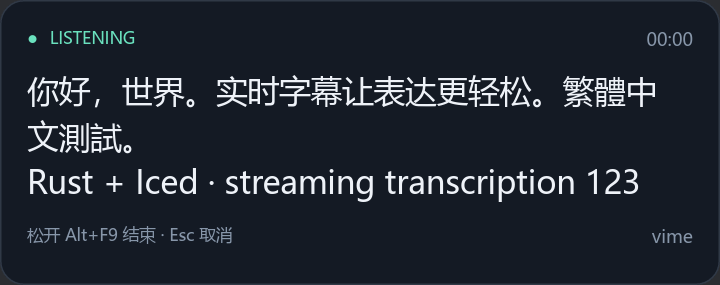

# vime

极简 Rust Windows 语音转写客户端：按住 **Alt+F9** 录音，松开后等待服务端最终转写，将文本写入剪贴板，并可交给外部脚本。支持配置成按一下开始、再按一下停止。

Iced 字幕浮窗显示实时文字与识别状态，托盘提供字幕开关、Restart 和 Stop。音频在录音期间通过 WebSocket 流式上传；正常时交付最终确认文本，出错时尽量交付已经收到的文字。程序不自动粘贴，也不保存转写历史。

目前只开发客户端和独立 mock。Mock 返回预设结果，不识别语音；真实模型及 NAS 适配器由你另行部署。协议见 [docs/PROTOCOL.md](docs/PROTOCOL.md)，是固定的 Realtime 转写子集，不能保证任意声称 OpenAI compatible 的服务直接可用。



## 构建与快速检查

Windows x64 发布包见 [Releases](https://github.com/TTTPOB/vime/releases)。解压后包含客户端、独立 mock、示例配置和协议文档。

安装稳定版 Rust，然后：

```sh
cargo test
cargo build --release
```

Windows 可执行文件为 `target/release/vime.exe` 和 `vime-mock.exe`。真实热键、麦克风、剪贴板功能在 Windows 用户登录会话运行；Linux 可开发、运行协议/mock/输出脚本测试，并用 WAV 验证网络链路。

复制 [vime.example.toml](vime.example.toml) 为 `vime.toml`。先在一个终端启动 mock：

```sh
cargo run --bin vime-mock -- --bind 127.0.0.1:8765
```

再在另一个终端验证配置和连接：

```sh
cargo run --bin vime -- --config vime.toml --check-config
cargo run --bin vime -- --config vime.toml --test-connection
cargo run --bin vime -- --config vime.toml --wav sample.wav --no-clipboard
```

`--wav` 把文件转换成协议音频格式并执行一次完整转写，最终文本会输出到 stdout，收集测试输出时请留意文本隐私；`--no-clipboard` 适合 Linux/CI，仍可执行配置的脚本。连接诊断验证握手和协议会话确认，不证明服务端识别质量。

Windows 实际使用：

```powershell
.\vime.exe --config .\vime.toml
```

配置使用 TOML，未知字段会报错。默认服务器为本机 mock，实际部署请修改 `server.url` 为 NAS 服务的完整 `wss://` URL，修改模型名。令牌通过 `server.api_key_env` 指定的环境变量提供，不要把令牌写进 URL。`--check-config` 检查文件结构与配置值；设备和服务器能力仍需运行验证。

## 脚本交付

`output.command` 是程序和参数数组，例如：

```toml
[output]
clipboard = true
command = ["python", "C:\\scripts\\on_transcript.py"]
script_timeout_ms = 10000
```

文本通过 UTF-8 stdin 原样传递，无额外换行，发送完成后关闭 stdin。程序不隐式调用 shell，不把识别文本拼入命令行。脚本应从 stdin 读取全部文本。

Python 脚本在 Windows 上可显式解码 UTF-8，避免依赖系统代码页：

```python
import os
import sys

text = sys.stdin.buffer.read().decode("utf-8")
status = os.environ["VIME_TRANSCRIPT_STATUS"]  # final 或 recovered
```

脚本环境变量 `VIME_TRANSCRIPT_STATUS` 区分正常结果 `final` 与错误恢复结果 `recovered`，stdin 始终只有纯文本。默认恢复也调用普通 `command`；可设置 `recovery_command = ["程序", "参数"]` 使用独立脚本，或设置 `recovery_command = []` 禁用恢复脚本（仍可更新剪贴板）。

先尝试写剪贴板，再独立尝试运行脚本；剪贴板被占用或写入失败也不会阻止脚本接收文字。所有输出错误合并报告，不自动重试。脚本非零退出或超时会报告失败，已经更新的剪贴板不会回滚。超时会结束直接子进程，首版不管理脚本自己创建的后台子进程。脚本 stdout/stderr 不继承客户端终端，避免转写文字进入常规日志；调试脚本时可让脚本自行记录。

## Windows 启动与关闭

这是当前用户会话中的后台程序，**不要安装成 Windows Service**。服务的 Session 0 无法替代用户的热键和剪贴板会话。需要自启动时，用启动文件夹或“仅当用户登录时运行”的计划任务，使用可执行文件与配置文件的绝对路径，不需要常规管理员权限。

默认以无控制台后台方式运行，空闲时只有托盘图标；按快捷键录音时，屏幕底部中央出现只读字幕卡片。成功提示在 0.6 秒后隐藏，部分恢复和报错提示保留 2 秒。等待最终转写及交付期间显示红色处理中状态，新的录音快捷键会被忽略，不进入队列。需要终端调试时加 `--foreground`，通过 Ctrl+C 停止；后台运行可执行 `.\vime.exe --config .\vime.toml --stop` 正常退出，也可在任务管理器结束 `vime.exe`。程序单实例运行，重复启动会报错。日志默认写入配置文件旁的 `vime.log`，可用 `--log-file PATH` 指定。Esc 取消正在处理的录音，不交付文字。

## 字幕与托盘

```toml
[overlay]
enabled = true
font_family = "Microsoft YaHei UI"

[tray]
enabled = true
```

字幕使用系统字体和高级文本排版，不打包字体文件。字体名称不存在时，日志记录警告并回退到系统 sans-serif。托盘的 **Show subtitles** 可在运行时开关字幕，**Restart** 取消当前识别并重新初始化热键监听，**Stop** 退出程序；Restart 沿用启动时配置，修改 TOML 后请 Stop 再启动。

`--no-window` 保留托盘和后台热键，全程隐藏字幕；`--no-tray` 隐藏托盘。两者一起使用时仅启动后台引擎，不初始化 GUI；仍可通过 `--stop` 退出。`--foreground` 可同时用于终端调试。关闭字幕窗口不会结束后台程序。

```powershell
.\vime.exe --config .\vime.toml --no-window
.\vime.exe --overlay-demo --no-tray
```

`--overlay-demo` 自动播放十秒的中文、英文和状态预览，不使用麦克风、识别服务或剪贴板。`--wav`、`--check-config`、`--test-connection` 和 `--stop` 保持无 GUI。截图、窗口验收和性能测量见 [docs/OVERLAY.md](docs/OVERLAY.md)。

## 验证与首版限制

自动化以 Linux 常规测试和 GitHub Actions Windows runner 为主。Windows job 应验证真实 API 与网络 mock，包括剪贴板、热键注册/冲突、消息处理以及构建产物；`SendInput` 需要实际桌面条件，不能把手动投递 `WM_HOTKEY` 当成系统识别组合键的证据。

真实麦克风、Windows 用户隐私授权、物理设备热插拔仍需实际 Windows 验证。虚拟音频 CI 能验证 WASAPI 采集链路，但不证明物理麦克风可用。仓库包含 workflow 不代表已在 GitHub 成功运行；以实际 Actions 日志和产物为准。

可选的虚拟声卡探针在一次性 CI runner 上明确授予麦克风访问权限；它不代替 Windows 11 隐私设置界面的实际验收，客户端不会修改本机权限。

已验证的 CI 记录与具体边界见 [docs/TESTING.md](docs/TESTING.md)，包括真实热键、剪贴板、后台启动/退出，以及虚拟声卡的真实 WASAPI 信号采集。

客户端不会默认保存音频或转写历史，日志不打印转写文本。为测试显式传入 mock 的 `--capture-wav` 才会保存收到的音频；`--report` 保存协议计数。

```sh
cargo run --bin vime-mock -- --scenario duplicate --report report.json --capture-wav received.wav
```

停止后等待最终结果有超时；断线、超时或识别错误时，若已收到文字，尽量写入剪贴板并执行脚本。恢复文本可能缺字或尚未最终修正，不能当成完整转写。尚未收到任何文字时无法恢复；用户取消时不交付。`--wav` 模式会将恢复文本输出到 stdout，但仍以非零状态退出；实时模式恢复后继续等待下一次录音。不自动重连/重放音频，也不自动重试脚本，避免重复结果。首版没有安装器、自动更新或后台子进程树管理。Release 可执行文件未经代码签名，Windows 可能显示 SmartScreen 提示。

MIT License。
